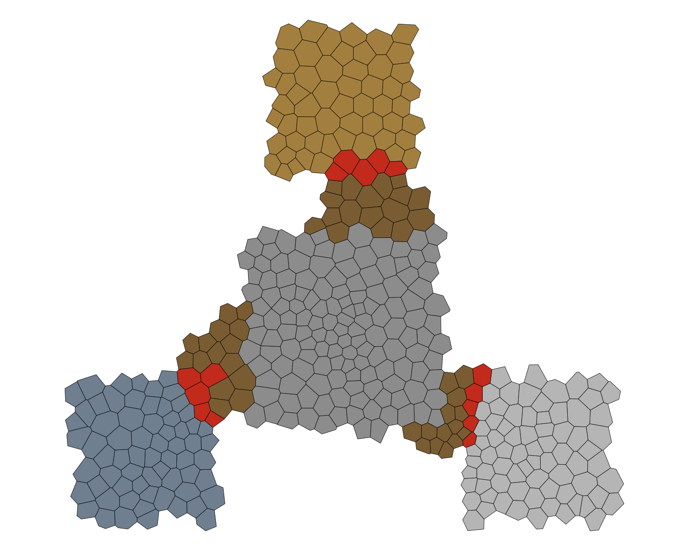
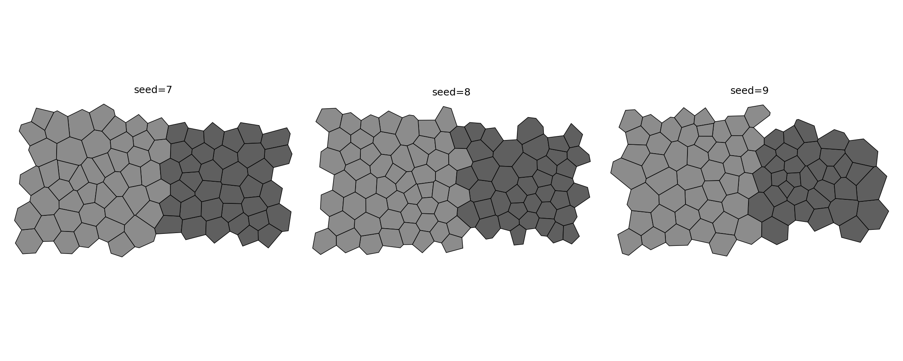

# DoomGen

Procedural Doom map generation for RL research. Define rooms and connections in a few lines of Python and get a playable WAD out, with full control over geometry, things, and map scripts.

The generator is Voronoi-first. A relaxed seed field (Lloyd's algorithm) is grouped into areas, linked with doors, corridors, and stairs, then converted to a Doom WAD. That gives organic non-grid layouts that stay fully seedable, which is what you want when training or evaluating agents.

DoomGen was built during the development of [COMRAD](https://github.com/TTomilin/COMRAD), a multi-agent benchmark suite in ViZDoom. The scenario generators under `examples/benchmark/` produced the COMRAD map pool.

Works with VizDoom / ZDoom 2.8.1+. Not GZDoom-specific.



Above is the Armory Siege scenario: a central hub with supply rooms off corridors. Areas are colored by their real floor textures, so the mesh shows what the map looks like. It was generated with this code.

```python
from examples.benchmark.armory_siege import ArmorySiegeScenario

scenario = ArmorySiegeScenario({"seed": 42})
scenario.generate("output/armory_siege.wad")
```

Every example under `examples/benchmark/` works the same way. A config dict in, a WAD out.

## Install

```bash
pip install doomgen
# with visualization helpers (matplotlib, pillow):
pip install "doomgen[viz]"
```

From source:

```bash
git clone https://github.com/mitkozh/DoomGen.git
cd DoomGen
pip install -e ".[dev]"
```

Requires Python 3.11 or 3.12. Runtime deps: `omgifol`, `shapely`, `numpy`, `scipy`. ACC and ZDBSP binaries ship under `src/doomgen/bin/` and are picked up automatically.

## Quick start

```python
from doomgen.builder import ProceduralMapBuilder
from doomgen.abstraction.layout import ConnectionType

builder = ProceduralMapBuilder(bounds=(-1024, -1024, 1024, 1024), num_seeds=250, seed=7)

# shape is (center_x, center_y, width, height)
builder.add_area("Main Hall", shape=(-350, 0, 900, 900), floor_texture="FLOOR4_8")
builder.add_area("Armory", shape=(500, 0, 800, 700), floor_texture="CEIL5_1")

# door from shared boundary cells; use connect_adjacent for open joins,
# add_corridor / add_stairs for distant areas (A* over the cell mesh)
builder.add_boundary("Main Hall", "Armory", name="Door", connection_type=ConnectionType.DOOR)

builder.add_thing("PLAYER1_START", -350, 0, angle=0)
builder.add_thing("PLAYER2_START", -350, 120, angle=0)
builder.add_thing("SHOTGUN", 500, 0, angle=0)
builder.add_thing("BOX_OF_SHELLS", 500, 120, angle=0)

builder.build("output/my_map.wad")
```

`build()` writes the WAD then runs the bundled ZDBSP if present. Override with `build(path, zdbsp_path=...)`. Without ZDBSP the WAD still loads (ZDoom rebuilds nodes).

## Seeds

Two knobs control the mesh. `num_seeds` sets how fine the cells are, `seed` fixes the output. Run the same code with the same seed and you get the same map back. Change the seed and the rooms stay where they are while every wall shifts. Below is the quick start snippet.



Coarse meshes build faster and suit large open areas. Fine meshes resolve small features like narrow doors and pillars. If an area claims zero cells, increase `num_seeds` or enlarge the shape.

## API map

| Import | Use |
| --- | --- |
| `doomgen.builder.ProceduralMapBuilder` | Main entrypoint (`add_area`, `add_corridor`, `add_stairs`, `add_boundary`, `connect_adjacent`, `add_thing`, `build`) |
| `doomgen.abstraction.layout` | `LayoutGraph`, `Area`, `AreaConfig`, `ConnectionType` |
| `doomgen.geometry.mesh` / `doomgen.geometry.seeds` | `VoronoiMesh`, `generate_relaxed_seeds` |
| `doomgen.logic.acs_builder` | `ACSBuilder`, `ScriptType` for map scripts (OPEN/ENTER/VOID, vars, triggers) |
| `doomgen.batch` | `Scenario`, `BatchGenerator` for param-grid WAD batches |
| `doomgen.doom` | `WADWriter`, `DoomMapData`, `MapTranslator`, `ThingType`, `run_zdbsp` |
| `doomgen.utils.paths` | `get_bundled_compiler("acc" \| "zdbsp")` |
| `doomgen.utils.visualization` | `visualize_mesh` (needs `doomgen[viz]`) |

`MapBuilder` is an alias of `ProceduralMapBuilder`.

## Examples

`examples/benchmark/` holds 16 scenario generators (arenas, mazes, platforming, asymmetric co-op) with batch variants in `examples/benchmark/batches/` and a curriculum script in `examples/benchmark/curriculum/`. These were written for COMRAD but work standalone. See `examples/benchmark/README.md` for the list. Minimal geometry demos (`test_voronoi.py`, `test_corridor.py`, `test_stairs.py`, …) are directly under `examples/`.

Generate one map:

```bash
python examples/benchmark/platform_chain.py
```

Batch example:

```python
from doomgen.batch import BatchGenerator
from examples.benchmark.platform_chain import PlatformChainScenario

for scenario in BatchGenerator(PlatformChainScenario, {"seed": [1, 2, 3]}).generate_scenarios("chain"):
    scenario.generate(f"output/{scenario.name}.wad")
```

Play locally (bundled Freedoom + VizDoom under `examples/play/`):

```bash
# Windows / Linux
play.bat
./play.sh
```

## Dev

```bash
pytest tests/ -v
ruff check src tests
```

## License

MIT. See `LICENSE`.
