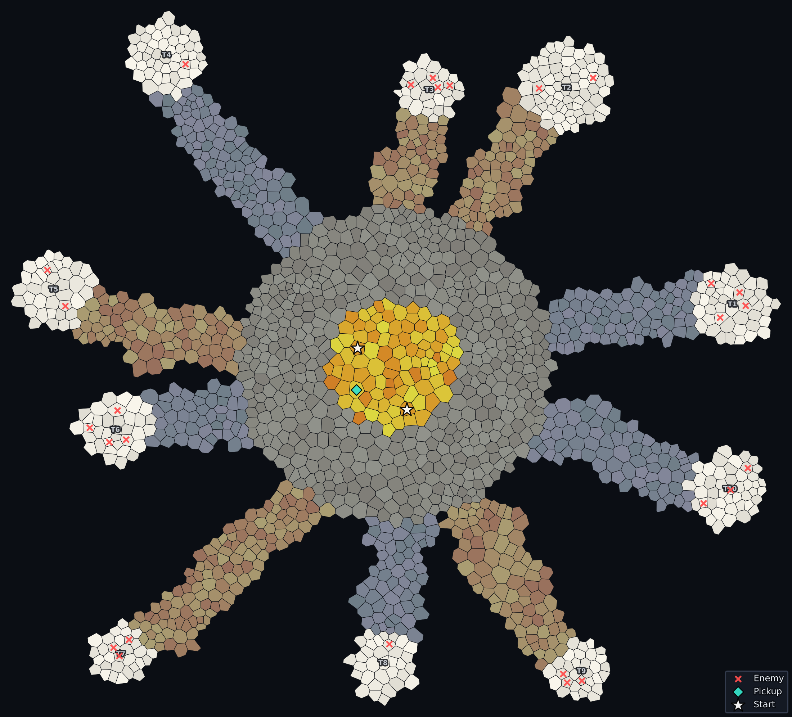
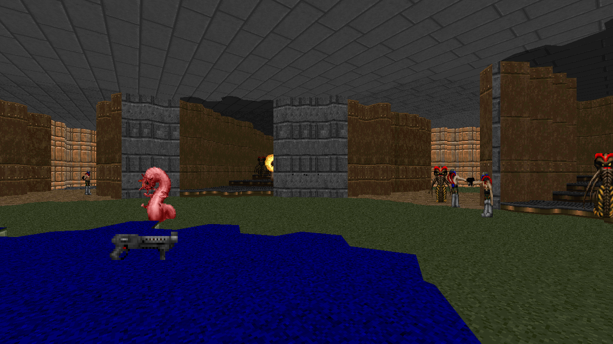
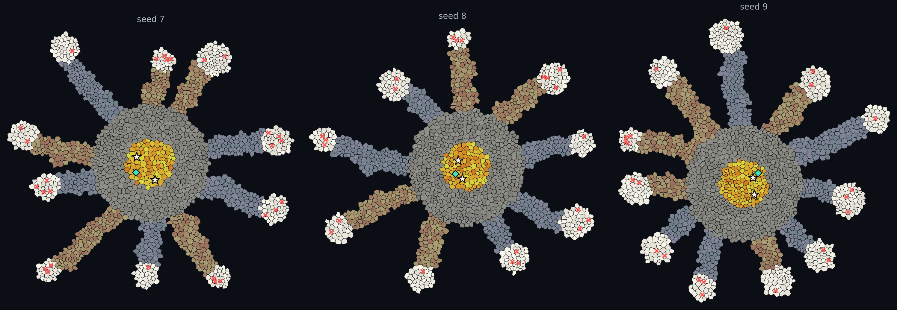

# DoomGen

<p align="center">
  <a href="https://lmbored.github.io/comrad_site/"></a>
</p>

<p align="center">
  <a href="https://pypi.org/project/doomgen/"></a>
  
  <a href="https://github.com/mitkozh/DoomGen/blob/main/LICENSE"></a>
  <a href="https://github.com/mitkozh/DoomGen/actions/workflows/ci.yml"></a>
</p>

DoomGen is a Python library for procedural Doom map generation. It builds complete, playable WAD files from a seed and a small layout description, with control over geometry, floor heights, textures, things, and map scripts.

<p align="center">
  
  
</p>

*A dandelion: a central puff with a golden core, thin filament corridors, and seed tufts - two of them raised on steep stairs. Cells are colored by area. Generated by [`examples/dandelion.py`](https://github.com/mitkozh/DoomGen/blob/main/examples/dandelion.py).*

## How it works

DoomGen constructs maps starting from a relaxed Voronoi tessellation. It groups irregular cells into semantically defined areas, such as spawn rooms, arenas, and corridors, before translating the resulting graph into valid Doom geometry. This geometric irregularity makes spatial memorization harder for learning agents. Layouts are fully deterministic given an integer seed.

Because DoomGen separates the rules of a task from its geometry, the same scenario can be instantiated across many layouts without changing its objective. You can generate a single scenario or batches of scenarios.

## Install

```bash
pip install doomgen
```

Requires Python 3.11 or 3.12. Wheels bundle ZDBSP for supported platforms. ACC is downloaded on demand for ACS compilation:

```bash
python -m doomgen.tools install acc
```

Optional visualization helpers:

```bash
pip install "doomgen[viz]"
```

From source:

```bash
git clone https://github.com/mitkozh/DoomGen.git
cd DoomGen
pip install -e ".[dev]"
```

## Quick start

```python
from doomgen import ConnectionType, ProceduralMapBuilder

builder = ProceduralMapBuilder(
    bounds=(-1200, -1200, 1200, 1200), num_seeds=600, seed=7
)

builder.add_area("Hall", (-350, 0, 900, 900), floor_texture="FLOOR4_8")
builder.add_area("Depot", (500, 0, 800, 700), floor_texture="CEIL5_1")
builder.add_area("Vault", (0, 850, 500, 350), floor_texture="FLAT22")

builder.add_boundary("Hall", "Depot", name="Door", connection_type=ConnectionType.DOOR)
builder.add_corridor("Hall", "Vault", width=2)

builder.add_thing("PLAYER1_START", -350, 0, angle=0)
builder.add_thing("SHOTGUN", 500, 0)

builder.build("output/map.wad")
```

`shape` is `(center_x, center_y, width, height)`. Use `add_boundary` for areas that share an edge, and `add_corridor` or `add_stairs` for areas separated by void. `connect_adjacent` creates an open join without a separate boundary area.

`build()` writes the WAD and runs the bundled ZDBSP.

## Seeds and batches

Every call is deterministic. The same code and seed reproduce the same map; changing the seed keeps the areas in place while walls, sightlines, and corridor routing shift.

<p align="center">
  
</p>

*The same dandelion at seeds 7, 8, and 9. The seed decides how many tufts exist, where they sit, which sit high, and what spawns in each. Generated by [`examples/dandelion.py`](https://github.com/mitkozh/DoomGen/blob/main/examples/dandelion.py).*

`num_seeds` sets the cell resolution. Coarse meshes build faster and suit large open spaces; finer meshes resolve narrow doors and small rooms. If an area claims no cells, raise `num_seeds` or enlarge its shape.

Generate a fixed batch over a parameter grid:

```python
from doomgen import ProceduralMapBuilder
from doomgen.batch import BatchGenerator, Scenario


class Arena(Scenario):
    def get_default_config(self):
        return {"seed": 1}

    def generate(self, output_path):
        builder = ProceduralMapBuilder(num_seeds=600, seed=self.config["seed"])
        builder.add_area("Arena", (0, 0, 1500, 1500))
        builder.add_thing("PLAYER1_START", 0, 0)
        builder.build(output_path)


batch = BatchGenerator(Arena, {"seed": [1, 2, 3]})
for scenario in batch.generate_scenarios("arena"):
    scenario.generate(f"output/{scenario.name}.wad")
```

## API


| Import                        | Contents                                                                                                          |
| ------------------------------- | ------------------------------------------------------------------------------------------------------------------- |
| `doomgen`                     | `ProceduralMapBuilder`, `ConnectionType`, `ThingType`, `DoomMapData`, `WADWriter`, `MapTranslator`, `VoronoiMesh` |
| `doomgen.abstraction.layout`  | `LayoutGraph`, `Area`, `AreaConfig`, `Transform`                                                                  |
| `doomgen.geometry`            | `VoronoiMesh`, `generate_relaxed_seeds`                                                                           |
| `doomgen.logic.acs_builder`   | `ACSBuilder`, `ScriptType` for ACS map scripts                                                                    |
| `doomgen.batch`               | `Scenario`, `BatchGenerator` for parameter-grid WAD batches                                                       |
| `doomgen.doom`                | `WADWriter`, `MapTranslator`, `ThingType`, `run_zdbsp`                                                            |
| `doomgen.utils.paths`         | `get_bundled_compiler("zdbsp")`, `resolve_compiler`                                                               |
| `doomgen.utils.visualization` | `visualize_mesh` (requires `doomgen[viz]`)                                                                        |

## Projects using DoomGen

- [COMRAD](https://github.com/TTomilin/COMRAD) - cooperative multi-agent reinforcement learning benchmark in ViZDoom. DoomGen was originally built for its procedural map pools.
- Add your project with a pull request.

## Examples

- [`examples/dandelion.py`](https://github.com/mitkozh/DoomGen/blob/main/examples/dandelion.py) - the dandelion layout above (`--render`), and the three-seed comparison (`--strip`, requires `doomgen[viz]`).
- [`examples/`](https://github.com/mitkozh/DoomGen/tree/main/examples) also contains smaller demos for Voronoi meshing, corridors, stairs, and organic routing.

## Development

```bash
git clone https://github.com/mitkozh/DoomGen.git
cd DoomGen
pip install -e ".[dev]"
pytest tests -v
ruff check src tests scripts setup.py
ruff format --check src tests scripts setup.py
mypy src/doomgen
```

## License

MIT. See [LICENSE](https://github.com/mitkozh/DoomGen/blob/main/LICENSE).
